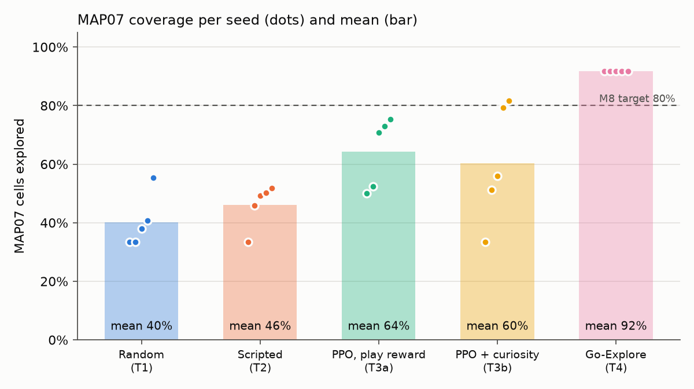
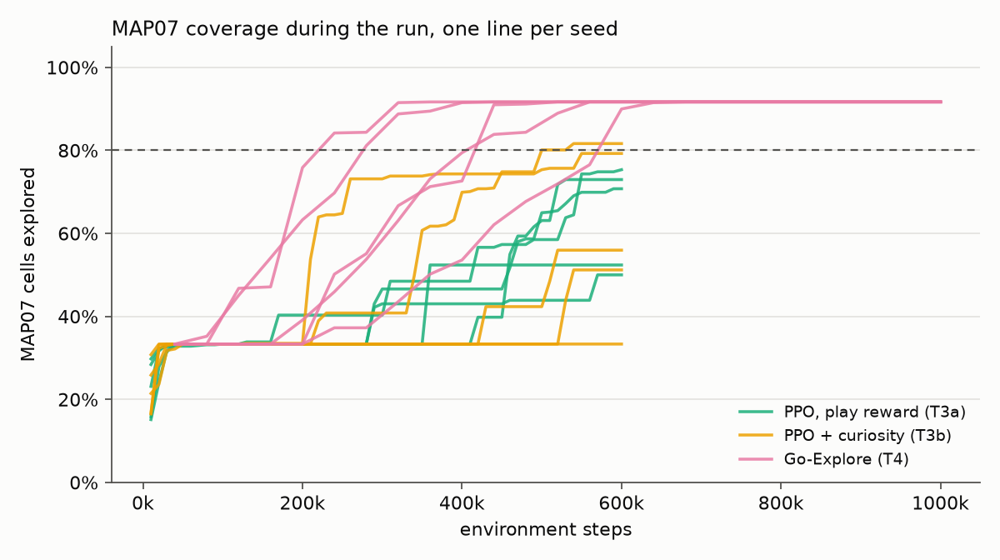
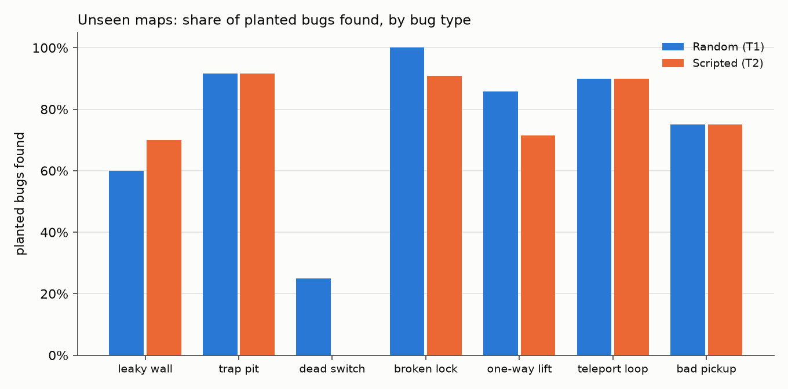

# Phase 1 results

Generated by `python scripts/make_results.py build` from `results/` alone. Every bug count is scored against the maps' answer keys with `qatester/report/scoring.py`: a report counts only if its detector family is the one the bug should trigger and it lies within 128 map units of the bug.

## MAP07 SPRAWL (12 rooms, 4 planted bugs)

| Tester | Steps | Seeds | Cells explored, final | at 600k steps | Bugs found (of 4) | False alarms |
|---|---|---|---|---|---|---|
| Random (T1) | 1000k | 5 | 40% ± 9 | — | 0.60 ± 0.89 (n=5) | 0 |
| Scripted (T2) | 1000k | 5 | 46% ± 7 | — | 0.80 ± 0.45 (n=5) | 0 |
| PPO, play reward (T3a) | 600k | 5 | 64% ± 12 | 64% ± 12 | 1.00 ± 1.41 (n=2) | 0 |
| PPO + curiosity (T3b) | 600k | 5 | 60% ± 20 | 60% ± 20 | 1.33 ± 1.15 (n=3) | 0 |
| Go-Explore (T4) | 1000k | 5 | 92% ± 0 | 91% ± 1 | 3.00 ± 0.00 (n=5) | 0 |

**M8 acceptance** (Go-Explore covers at least 80% of MAP07 at 1M steps): 5 of 5 seeds, **PASS**.

- T3b > T3a on final MAP07 coverage: one-sided Mann-Whitney U = 13, p = 0.500, A12 = 0.52
- T4 > T3a on final MAP07 coverage: one-sided Mann-Whitney U = 25, p = 0.004, A12 = 1.00
- T4 > T1 on final MAP07 coverage: one-sided Mann-Whitney U = 25, p = 0.004, A12 = 1.00

The PPO tiers trained for 600k steps. The random, scripted and Go-Explore testers ran 1M; the *at 600k* column compares them at the PPO budget where a curve exists.

## Maps no tester was tuned on

32 generated maps from the *test* split (never used in training), MAP08 HOLDOUT, and the hand-made maps MAP01-MAP06 (MAP01 has no bugs: any report there is a false alarm). About 100k steps per map.

| Tester | Maps | Bug reports | False alarms | Precision | Planted bugs found | Recall | Cells explored, mean |
|---|---|---|---|---|---|---|---|
| Random (T1) | 39 | 65 | 1 | 98% | 51 / 66 | 77% | 69% |
| Scripted (T2) | 39 | 59 | 1 | 98% | 48 / 66 | 73% | 60% |

Planted bugs found, by type:

| Bug type | Random (T1) | Scripted (T2) |
|---|---|---|
| leaky wall | 6 / 10 | 7 / 10 |
| trap pit | 11 / 12 | 11 / 12 |
| dead switch | 2 / 8 | 0 / 8 |
| broken lock | 11 / 11 | 10 / 11 |
| one-way lift | 6 / 7 | 5 / 7 |
| teleport loop | 9 / 10 | 9 / 10 |
| bad pickup | 6 / 8 | 6 / 8 |

## PPO + curiosity on the curriculum (71 training maps, 2M steps)

| Seed | Bug reports | False alarms | Precision | Planted bugs found | Recall |
|---|---|---|---|---|---|
| 0 | 21 | 0 | 100% | 20 / 119 | 17% |
| 1 | 30 | 0 | 100% | 28 / 119 | 24% |

